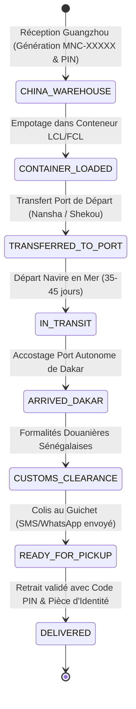
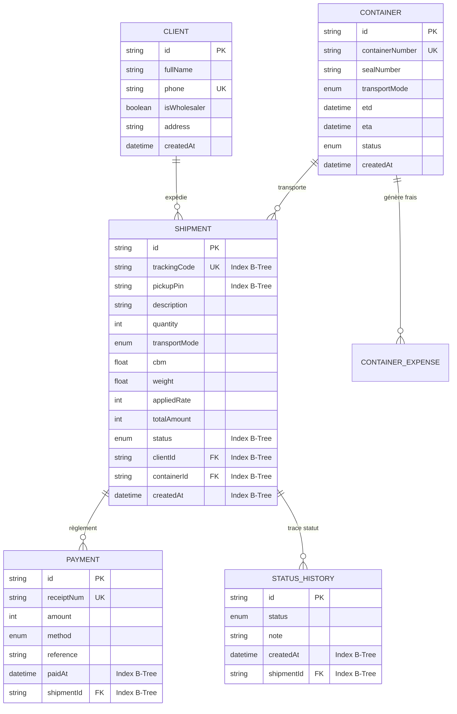

# 🏗️ Architecture Technique & Modèle Métier — Minane Cargo

Ce document présente l'architecture logicielle, les choix de conception et le modèle de données de la plateforme Minane Cargo.

---

## 1. Modèle Métier : Cycle de Vie d'un Colis Maritime

Le fret maritime entre la Chine et le Sénégal suit une machine à états stricte représentée par l'énumération `ShipmentStatus` :



### Règles d'or métier :
1. **Unicité & Traçabilité** : Chaque colis possède un identifiant `trackingCode` unique au format `MNC-XXXX[A-Z]` (ex: `MNC-8492A`).
2. **Code PIN Confidentiel** : Un code PIN à 4 chiffres est généré lors de la réception à Guangzhou. Il est strictement confidentiel et requis au guichet de Dakar pour délivrer le colis.
3. **Facturation au CBM** : Le calcul du montant s'effectue sur le volume réel en mètres cubes ($L \times l \times H$), avec un taux configurable depuis l'espace administrateur (par défaut 165 000 FCFA/CBM).
4. **Paiement Multi-Canal** : Un colis peut être soldé à Guangzhou ou à Dakar par Wave, Orange Money, Virement bancaire ou Espèces (Cash). Le reçu de paiement porte un numéro unique généré (`REC-YYYYMMDD-XXXX`).

---

## 2. Modèle de Données Relationnel (PostgreSQL / Prisma)

### Schéma Entité-Association



### Stratégie d'Indexation Haute Performance :
Pour garantir des temps de réponse inférieurs à **5 millisecondes**, même avec des centaines de milliers de colis, les index B-Tree suivants sont configurés :
- `Shipment.trackingCode` (Unique) : Recherche instantanée sur le formulaire de tracking public.
- `Shipment.status` : Filtres rapides par onglet sur le tableau de bord administrateur.
- `Shipment.clientId` & `Shipment.containerId` : Jointures relationnelles optimisées.
- `Shipment.createdAt` : Tri chronologique des arrivages.
- `Payment.shipmentId` : Calcul instantané du reste à payer lors de la consultation.

---

## 3. Architecture Logicielle & Design Patterns (SOLID / MVC)

Le projet respecte une séparation stricte des responsabilités (Separation of Concerns) organisée en 4 couches côté Backend et une structure par composants découplés côté Frontend :

```text
CLIENT (Navigateur / React SPA)
       │
       ▼  Requête HTTP (JSON / REST API)
[ 1. ROUTES (src/routes/) ]
       │  - Déclaration des routes & verbes HTTP
       │  - Middleware de sécurité (JWT, Sanitize, Rate Limit)
       ▼
[ 2. CONTROLLERS (src/controllers/) ]
       │  - Validation des inputs HTTP (status codes 400, 404, 500)
       │  - Formatage des réponses JSON
       │  - Appel des services métier
       ▼
[ 3. SERVICES (src/services/) ]
       │  - Logique métier pure (calculs de CBM, validation métier)
       │  - Enrichissement des entités (totalPaid, balance, status)
       │  - Transactions complexes et règles de transition d'états
       ▼
[ 4. DATA ACCESS (Prisma ORM & PostgreSQL) ]
          - Modèles typés avec indexation B-Tree
          - Protection contre l'injection SQL
```

### Principes SOLID appliqués :
- **S (Single Responsibility Principle)** :
  - Chaque contrôleur ne gère que les entrées/sorties HTTP de son domaine (`auth`, `shipment`, `container`, `payment`, `client`, `settings`).
  - Les services encapsulent les règles de calcul et d'enrichissement métier.
  - Côté Frontend, le tableau de bord `AdminDashboard.jsx` est découpé en onglets indépendants (`ShipmentsTab`, `ContainersTab`, `CashTab`, `SettingsTab`) et en modales dédiées (`NewShipmentModal`, `DeliverModal`, etc.).
- **O (Open/Closed Principle)** :
  - Les calculateurs de tarifs et générateurs de statuts sont extensibles sans modifier les handlers HTTP.
- **L (Liskov Substitution Principle)** :
  - Gestion standardisée des erreurs et formats de réponses prévisibles (`{ error: string }` ou `{ message: string, ... }`).
- **I (Interface Segregation Principle)** :
  - Les endpoints exposent uniquement les données requises pour chaque vue (ex: route publique `/api/tracking/:code` allégée et exempte de données sensibles telles que le PIN ou les montants d'achat).
- **D (Dependency Inversion Principle)** :
  - Les contrôleurs et services dépendent de modules abstraits de base de données (`../prisma`), d'utilitaires de validation (`VALIDATORS`) et de générateurs (`generators.js`).

---

## 4. Architecture de Sécurité Multi-Couches

L'application applique le principe de défense en profondeur (*Defense in Depth*) :

```text
Requête Entrante HTTP
       │
       ▼
[ 1. Headers de Sécurité ]  ──> HSTS, CSP (Anti-injection), X-Frame-Options, Nosniff
       │
       ▼
[ 2. CORS Whitelist ]       ──> Rejette toute origine non autorisée (Allow Same-Origin)
       │
       ▼
[ 3. Limiteur de Débit ]    ──> 120 req/min global + 5 tentatives/15min sur Login
       │
       ▼
[ 4. Payload Size Limit ]   ──> Limite stricte à 50 Ko (Anti DoS mémoire)
       │
       ▼
[ 5. Sanitizer Récursif ]   ──> Nettoie XSS, supprime __proto__, constructor, null-bytes
       │
       ▼
[ 6. SQL Injection Guard ]  ──> Détection d'expressions SQL malveillantes
       │
       ▼
[ 7. Authentification JWT ] ──> Clé HMAC SHA-256 (128 chars), Issuer vérifié
       │
       ▼
[ 8. Requêtes Prisma ORM ]  ──> Requêtes paramétrées sécurisées en base de données
```

---

## 5. Politique "Zero-Storage" (Client-Side Rendering)

Plutôt que d'héberger des milliers de fichiers PDF sur des buckets cloud coûteux (AWS S3, Google Cloud Storage) avec les risques de fuites associés :
* **Aucun fichier PDF n'est stocké côté serveur**.
* Les factures pro-forma, bordereaux de transport et reçus de caisse sont générés **dynamiquement en JavaScript côté navigateur client** grâce à `jsPDF` et `jspdf-autotable`.
* Les données sources sont protégées par l'API et le PDF est téléchargé instantanément par le client ou l'administrateur.

---

## 6. Configuration Centralisée & Dynamique

Toutes les coordonnées de l'entreprise (numéro de Dakar, WhatsApp, adresse de Guangzhou, bannières d'annonces, tarifs au CBM) sont modifiables à tout moment depuis le tableau de bord administrateur (onglet **Paramètres**) sans aucun redéploiement de code :
* Sauvegardées dans la table `AppSettings` de la base de données.
* Propagées instantanément au frontend via l'utilitaire `company.js`.
* Valeur par défaut de secours intégrée en cas d'absence de connexion base de données.

